## 匿名化完整示例报告：PYML接口验证

真实EEG全部696特征与显式人工目标；方法、结果及简短讨论。

匿名化历史示例：仅展示人工目标接口验证，不作为新研究结果。

## 方法

### 目的与数据来源

本模板检验主包全部方法在正确输入契约下是否能完成实际拟合、保存任务输出并生成结果报告。真实数据来自两张已转换表：整段18行、片段49行，各696特征，均保留全部列、全部记录和原缺失位置；两表分开，不把记录或窗口当作独立被试。身份依据原生study.json中的人工确认映射，整段6人、片段5人。原始会话属于被试内设计，本模板的人工目标不等于该实验的真实条件。

### 人工目标和任务契约

二分类沿用已冻结的人工0/1；三分类在各被试内平衡随机分配0/1/2。连续回归使用固定种子的正对数正态目标，Poisson回归使用1+Poisson(3)的正整数目标。目标不根据EEG特征或模型分数选择；标签、数值与生成规则保存于目标字典，不赋予生理、临床或实验条件含义。

窗口回归使用真实696列特征及正连续人工目标，但顺序由样本ID产生并显著标为ARTIFICIAL，窗口2、horizon=1；它不是恢复的真实时间。原生单变量T01–T05只消费目标历史，因此使用独立120点人工趋势/周期/噪声夹具，不能称为利用了696维EEG外生输入。H03使用人工离散符号；H01使用按训练分区中位数填补并标准化后的真实696维输入。H02在极少、高维真实观测上的预检出现EM退化，正式混合发射接口例使用独立180点、3特征的人工GMM序列；原始真实数据没有因此被删改，也不把夹具通过当作解决了该真实数据的估计限制。

**表 1** *任务与实际输入范围*

任务 | 目标/观测 | 输入与来源 | 解释范围
--- | --- | --- | ---
二/三分类 | 人工0/1或0/1/2 | 18×696、49×696真实特征 | 工程分类指标与敏感性
连续/Gamma/Tweedie回归 | 人工正连续目标 | 两张真实全特征表 | 人工目标误差
Poisson回归 | 人工正整数目标 | 两张真实全特征表 | 计数接口与偏差
窗口神经回归 | 正连续目标＋人工顺序 | 真实696维；窗口2 | 不是真实时序结论
单变量预测 | 独立人工目标历史 | 每夹具120点；EEG不作外生变量 | 固定起点接口
HMM | 真实有限值/人工混合/离散符号 | H01真实696维；H02人工3维；H03人工符号 | 不可跨发射维数比较似然
无监督 | 不需要因变量 | 两张真实全特征表 | 全量描述性输出

注。完整目标、人工顺序和预处理依据均保存在data/；不得把所有行笼统称为真实科研标签或全合成特征。

### 划分、预处理与修复

普通表格模型按被试group划分，学习型填补和缩放只在训练分区拟合。10次循环使用预先指定的种子，验证被试可重复出现；它们不是10个独立实验，也没有跨全部循环始终独立的最终测试集。窗口与HMM由原生SequencePlan保留组边界，人工顺序对应的分区按保存的计划固定；预测夹具按人工顺序划分。所有流程只运行开发数据接口，最终test API未调用。

上轮40项未通过包含两种原因：QDA默认协方差估计无法在每类约4–5个训练观测下直接估计696维；C30原生接口当时缺少按被试分组的内部OOF支持。前者改用显式eigen求解器与0.5协方差收缩，属于兼容参数修订；后者在主包中增加分组内部CV，并在训练入口传递拥有的组元数据，成员管线在每个内折重新拟合预处理。分类与回归均保存内部折被试审计。RANSAC的min_samples改为训练样本的0.5，避免默认最小抽样量超过可用记录。修复均另建冻结运行，没有覆写旧失败或旧分数。

### 算法差异与输出

线性分类器在逻辑损失、间隔、惩罚与求解方式上不同；树的平均集成与逐阶段提升具有不同训练依赖。近邻依靠距离，贝叶斯方法依靠条件分布假设。回归的均值、分位数、鲁棒和分布受限目标不能互相替代（Pedregosa et al., 2011; Breiman, 2001; Scikit-learn developers, n.d.）。外部提升实现保留各自参数与类别处理契约（XGBoost developers, n.d.; LightGBM developers, n.d.; CatBoost developers, n.d.）。深度模块通过PyTorch/skorch适配，HMM通过hmmlearn发射与边界契约；时序适配器遵循固定起点历史（PyTorch contributors, n.d.; Skorch developers, n.d.; Hmmlearn developers, n.d.; Statsmodels developers, n.d.）。

搜索与训练前降维单列为流程方法。搜索最多2个候选拟合，退火使用连续C范围，其余按固定候选规则；五种训练前降维仅在训练分区将696维变为2维再接C01（Bergstra & Bengio, 2012; Optuna contributors, n.d.）。独立降维、聚类及异常检测在真实表全量拟合，不声称留出泛化；PCA、ICA、t-SNE、UMAP等的表示目标不同，图形分离本身不是统计效应（van der Maaten & Hinton, 2008; UMAP developers, n.d.）。完整逐方法差异及参数见附录。

### 指标、图表与接续

分类报告accuracy、balanced accuracy、macro F1及AUC：二分类正类1，三分类采用OvR宏平均，分数必须来自真实概率或连续决策输出。回归报告MAE、RMSE和适用的R²；验证少于2个观测或目标恒定时，报告层将R²标为不可解释并保留原生值及原因。Poisson和Gamma另从已保存预测计算适用偏差。所有数值按来源、目标、表和评价单位分组，不混排不同任务。

分类特征置换从完整已拟合流程的原始696列输入进行，每列每循环1次，按验证balanced accuracy下降量保存负值和全部排序；10次种子仅作均值与SD描述。原生系数和树不纯度解释另存。向量化批量预测只减少计算开销，不重新训练、不改变定义；与旧逐列实现有数值对照。结果文件落盘并完成任务检查后才提交布尔PASS；错误分类、警告和冻结清单在独立文件中保存，输入/代码/环境变化拒绝直接接续。

## 结果

### 实际覆盖与输入契约

当前实际清单为326条方法×目标×表流程，各10次，共3260个槽位；3254项通过，6项未通过，0项未提交。全部111个模型及5种搜索、5种训练前降维均保留在覆盖清单。这里是槽位数，不是包含集成成员、搜索和内部CV的真实fit调用总数。

**表 2** *全部目标类型的执行状态*

目标/任务 | 预定 | PASS | 未通过 | 未提交
--- | --- | --- | --- | ---
binary | 840 | 840 | 0 | 0
multiclass | 840 | 840 | 0 | 0
continuous | 720 | 720 | 0 | 0
count | 20 | 20 | 0 | 0
unsupervised | 580 | 580 | 0 | 0
forecast | 100 | 100 | 0 | 0
sequence | 100 | 100 | 0 | 0
hmm | 60 | 54 | 6 | 0

注。不删除失败方法制造覆盖；输入实际维数与来源见tables/data-contracts.csv。最终test调用数为0。

### 分类结果：表格与逐模型准确率/AUC图

以下用预先固定的C01展示结果读法，不按分数选择示例：表1二分类的accuracy = 0.533（SD = 0.281），AUC = 0.550（SD = 0.369）；表2二分类的accuracy = 0.489（SD = 0.053），AUC = 0.404（SD = 0.219）；表1三分类的accuracy = 0.333（SD = 0.272），AUC = 0.450（SD = 0.315）；表2三分类的accuracy = 0.377（SD = 0.077），AUC = 0.557（SD = 0.118）。这些数值对应人工标签下的开发验证，不代表真实实验条件的解码能力。

**表 3** *表1的二分类验证结果*

模型 | 次数 | accuracy M (SD) | AUC M (SD) | macro F1
--- | --- | --- | --- | ---
model:C01 | 10 | 0.533 (0.281) | 0.550 (0.369) | 0.457
model:C02 | 10 | 0.533 (0.281) | 0.450 (0.369) | 0.483
model:C03 | 10 | 0.467 (0.281) | 0.600 (0.394) | 0.400
model:C04 | 10 | 0.500 (0.283) | 0.450 (0.369) | 0.415
model:C05 | 10 | 0.467 (0.281) | 0.600 (0.394) | 0.400
model:C06 | 10 | 0.467 (0.322) | 0.500 (0.408) | 0.390
model:C07 | 10 | 0.500 (0.176) | 0.575 (0.334) | 0.325
model:C08 | 10 | 0.500 (0.283) | 0.550 (0.284) | 0.440
model:C09 | 10 | 0.533 (0.233) | 0.550 (0.197) | 0.412
model:C10 | 10 | 0.367 (0.246) | 0.450 (0.438) | 0.300
model:C11 | 10 | 0.300 (0.292) | 0.425 (0.409) | 0.250
model:C12 | 10 | 0.367 (0.246) | 0.450 (0.438) | 0.300
model:C13 | 10 | 0.333 (0.000) | 0.400 (0.394) | 0.250
model:C14 | 10 | 0.467 (0.281) | 0.550 (0.258) | 0.398
model:C15 | 10 | 0.500 (0.324) | 0.575 (0.290) | 0.432
model:C16 | 10 | 0.333 (0.222) | 0.325 (0.290) | 0.257
model:C17 | 10 | 0.367 (0.189) | 0.375 (0.358) | 0.282
model:C18 | 10 | 0.467 (0.358) | 0.550 (0.350) | 0.407
model:C19 | 10 | 0.500 (0.176) | 0.500 (0.000) | 0.325
model:C20 | 10 | 0.300 (0.189) | 0.425 (0.290) | 0.215
model:C21 | 10 | 0.533 (0.233) | 0.400 (0.459) | 0.412
model:C22 | 10 | 0.500 (0.236) | 0.450 (0.497) | 0.450
model:C23 | 10 | 0.367 (0.105) | 0.425 (0.169) | 0.265
model:C24 | 10 | 0.533 (0.172) | 0.500 (0.000) | 0.340
model:C25 | 10 | 0.500 (0.176) | 0.500 (0.000) | 0.325
model:C26 | 10 | 0.500 (0.176) | 0.500 (0.000) | 0.325
model:C27 | 10 | 0.400 (0.211) | 0.300 (0.350) | 0.323
model:C28 | 10 | 0.500 (0.176) | 0.500 (0.000) | 0.325
model:C29 | 10 | 0.567 (0.316) | 0.650 (0.412) | 0.515
model:C30 | 10 | 0.567 (0.353) | 0.475 (0.416) | 0.425
model:C31 | 10 | 0.400 (0.306) | 0.475 (0.432) | 0.305
model:N01 | 10 | 0.667 (0.272) | 0.650 (0.474) | 0.615

注。按ID排列；图中同时保留不可估计模型。整段每次验证仅3行，指标粒度很粗；SD不是独立样本置信区间。

**表 4** *表2的二分类验证结果*

模型 | 次数 | accuracy M (SD) | AUC M (SD) | macro F1
--- | --- | --- | --- | ---
model:C01 | 10 | 0.489 (0.053) | 0.404 (0.219) | 0.362
model:C02 | 10 | 0.489 (0.053) | 0.360 (0.174) | 0.350
model:C03 | 10 | 0.459 (0.133) | 0.396 (0.239) | 0.341
model:C04 | 10 | 0.499 (0.063) | 0.380 (0.218) | 0.369
model:C05 | 10 | 0.469 (0.104) | 0.388 (0.228) | 0.360
model:C06 | 10 | 0.469 (0.043) | 0.368 (0.193) | 0.344
model:C07 | 10 | 0.471 (0.093) | 0.474 (0.079) | 0.330
model:C08 | 10 | 0.491 (0.053) | 0.520 (0.079) | 0.398
model:C09 | 10 | 0.489 (0.097) | 0.457 (0.155) | 0.400
model:C10 | 10 | 0.541 (0.066) | 0.548 (0.168) | 0.430
model:C11 | 10 | 0.521 (0.089) | 0.390 (0.127) | 0.407
model:C12 | 10 | 0.541 (0.066) | 0.548 (0.168) | 0.430
model:C13 | 10 | 0.509 (0.118) | 0.464 (0.227) | 0.406
model:C14 | 10 | 0.507 (0.139) | 0.504 (0.147) | 0.402
model:C15 | 10 | 0.501 (0.082) | 0.527 (0.098) | 0.390
model:C16 | 10 | 0.507 (0.147) | 0.539 (0.181) | 0.446
model:C17 | 10 | 0.530 (0.128) | 0.452 (0.146) | 0.449
model:C18 | 10 | 0.477 (0.116) | 0.430 (0.179) | 0.419
model:C19 | 10 | 0.511 (0.023) | 0.500 (0.000) | 0.338
model:C20 | 10 | 0.427 (0.095) | 0.381 (0.140) | 0.378
model:C21 | 10 | 0.489 (0.023) | 0.466 (0.155) | 0.340
model:C22 | 10 | 0.489 (0.071) | 0.594 (0.113) | 0.373
model:C23 | 10 | 0.511 (0.023) | 0.500 (0.000) | 0.338
model:C24 | 10 | 0.511 (0.023) | 0.500 (0.000) | 0.338
model:C25 | 10 | 0.437 (0.178) | 0.393 (0.291) | 0.402
model:C26 | 10 | 0.511 (0.023) | 0.500 (0.000) | 0.338
model:C27 | 10 | 0.569 (0.143) | 0.483 (0.249) | 0.498
model:C28 | 10 | 0.511 (0.023) | 0.500 (0.000) | 0.338
model:C29 | 10 | 0.497 (0.144) | 0.397 (0.240) | 0.409
model:C30 | 10 | 0.532 (0.058) | 0.562 (0.245) | 0.410
model:C31 | 10 | 0.561 (0.133) | 0.505 (0.181) | 0.485
model:N01 | 10 | 0.479 (0.121) | 0.461 (0.176) | 0.411

注。按ID排列；图中同时保留不可估计模型。整段每次验证仅3行，指标粒度很粗；SD不是独立样本置信区间。

**表 5** *表1的三分类验证结果*

模型 | 次数 | accuracy M (SD) | AUC M (SD) | macro F1
--- | --- | --- | --- | ---
model:C01 | 10 | 0.333 (0.272) | 0.450 (0.315) | 0.244
model:C02 | 10 | 0.367 (0.246) | 0.550 (0.334) | 0.278
model:C03 | 10 | 0.367 (0.189) | 0.483 (0.288) | 0.261
model:C04 | 10 | 0.300 (0.246) | 0.567 (0.316) | 0.217
model:C05 | 10 | 0.367 (0.189) | 0.483 (0.288) | 0.261
model:C06 | 10 | 0.333 (0.222) | 0.567 (0.344) | 0.239
model:C07 | 10 | 0.333 (0.000) | 0.483 (0.266) | 0.167
model:C08 | 10 | 0.433 (0.161) | 0.517 (0.232) | 0.294
model:C09 | 10 | 0.300 (0.105) | 0.475 (0.079) | 0.172
model:C10 | 10 | 0.267 (0.141) | 0.583 (0.264) | 0.183
model:C11 | 10 | 0.267 (0.263) | 0.550 (0.261) | 0.194
model:C12 | 10 | 0.200 (0.172) | 0.500 (0.294) | 0.133
model:C13 | 10 | 0.233 (0.274) | 0.508 (0.287) | 0.178
model:C14 | 10 | 0.433 (0.274) | 0.575 (0.206) | 0.317
model:C15 | 10 | 0.300 (0.189) | 0.475 (0.142) | 0.183
model:C16 | 10 | 0.500 (0.176) | 0.558 (0.142) | 0.378
model:C17 | 10 | 0.267 (0.211) | 0.525 (0.249) | 0.206
model:C18 | 10 | 0.367 (0.189) | 0.650 (0.214) | 0.283
model:C19 | 10 | 0.333 (0.000) | 0.500 (0.000) | 0.167
model:C20 | 10 | 0.300 (0.246) | 0.583 (0.226) | 0.222
model:C21 | 10 | 0.300 (0.246) | 0.692 (0.184) | 0.200
model:C22 | 10 | 0.433 (0.161) | 0.400 (0.179) | 0.306
model:C23 | 10 | 0.333 (0.000) | 0.542 (0.090) | 0.167
model:C24 | 10 | 0.333 (0.000) | 0.500 (0.000) | 0.167
model:C25 | 10 | 0.533 (0.233) | 0.750 (0.142) | 0.456
model:C26 | 10 | 0.333 (0.000) | 0.500 (0.000) | 0.167
model:C27 | 10 | 0.367 (0.189) | 0.667 (0.272) | 0.261
model:C28 | 10 | 0.333 (0.000) | 0.500 (0.000) | 0.167
model:C29 | 10 | 0.433 (0.274) | 0.550 (0.324) | 0.328
model:C30 | 10 | 0.267 (0.141) | 0.467 (0.270) | 0.150
model:C31 | 10 | 0.400 (0.211) | 0.600 (0.214) | 0.278
model:N01 | 10 | 0.233 (0.161) | 0.500 (0.261) | 0.128

注。按ID排列；图中同时保留不可估计模型。整段每次验证仅3行，指标粒度很粗；SD不是独立样本置信区间。

**表 6** *表2的三分类验证结果*

模型 | 次数 | accuracy M (SD) | AUC M (SD) | macro F1
--- | --- | --- | --- | ---
model:C01 | 10 | 0.377 (0.077) | 0.557 (0.118) | 0.241
model:C02 | 10 | 0.417 (0.063) | 0.592 (0.150) | 0.256
model:C03 | 10 | 0.387 (0.086) | 0.592 (0.160) | 0.265
model:C04 | 10 | 0.427 (0.068) | 0.609 (0.161) | 0.282
model:C05 | 10 | 0.387 (0.072) | 0.603 (0.162) | 0.263
model:C06 | 10 | 0.427 (0.068) | 0.590 (0.153) | 0.265
model:C07 | 10 | 0.317 (0.032) | 0.515 (0.130) | 0.160
model:C08 | 10 | 0.392 (0.175) | 0.479 (0.140) | 0.257
model:C09 | 10 | 0.357 (0.082) | 0.475 (0.133) | 0.230
model:C10 | 10 | 0.337 (0.094) | 0.585 (0.162) | 0.188
model:C11 | 10 | 0.287 (0.082) | 0.576 (0.171) | 0.189
model:C12 | 10 | 0.357 (0.125) | 0.598 (0.138) | 0.214
model:C13 | 10 | 0.357 (0.094) | 0.635 (0.122) | 0.240
model:C14 | 10 | 0.358 (0.073) | 0.532 (0.043) | 0.233
model:C15 | 10 | 0.398 (0.054) | 0.542 (0.049) | 0.279
model:C16 | 10 | 0.306 (0.136) | 0.427 (0.147) | 0.238
model:C17 | 10 | 0.327 (0.103) | 0.496 (0.120) | 0.212
model:C18 | 10 | 0.339 (0.079) | 0.516 (0.133) | 0.214
model:C19 | 10 | 0.317 (0.032) | 0.500 (0.000) | 0.160
model:C20 | 10 | 0.324 (0.086) | 0.540 (0.067) | 0.220
model:C21 | 10 | 0.356 (0.127) | 0.565 (0.150) | 0.221
model:C22 | 10 | 0.354 (0.090) | 0.498 (0.162) | 0.245
model:C23 | 10 | 0.327 (0.041) | 0.503 (0.007) | 0.164
model:C24 | 10 | 0.347 (0.048) | 0.500 (0.000) | 0.171
model:C25 | 10 | 0.381 (0.103) | 0.536 (0.156) | 0.272
model:C26 | 10 | 0.317 (0.032) | 0.500 (0.000) | 0.160
model:C27 | 10 | 0.347 (0.116) | 0.532 (0.120) | 0.258
model:C28 | 10 | 0.317 (0.032) | 0.500 (0.000) | 0.160
model:C29 | 10 | 0.408 (0.063) | 0.603 (0.119) | 0.275
model:C30 | 10 | 0.297 (0.037) | 0.520 (0.121) | 0.154
model:C31 | 10 | 0.410 (0.143) | 0.566 (0.135) | 0.328
model:N01 | 10 | 0.348 (0.057) | 0.553 (0.139) | 0.198

注。按ID排列；图中同时保留不可估计模型。整段每次验证仅3行，指标粒度很粗；SD不是独立样本置信区间。

对应的四张逐模型对比图分别展示两张表的二分类和三分类准确率、AUC，不以表格或单条ROC代替跨模型图。人工标签下偶然高分不构成真实解码或临床效度，不据此选择最佳EEG模型。完整逐类指标、预测/分数与所有696列排序在JSON及CSV中保留。

**表 7** *参数搜索接C01的实际验证输出*

目标 | 表 | 方法 | 次数 | accuracy | AUC
--- | --- | --- | --- | --- | ---
binary | 1 | search:annealing | 10 | 0.500 | 0.500
binary | 1 | search:genetic | 10 | 0.533 | 0.550
binary | 1 | search:grid | 10 | 0.533 | 0.550
binary | 1 | search:random | 10 | 0.533 | 0.550
binary | 1 | search:tpe | 10 | 0.533 | 0.550
binary | 2 | search:annealing | 10 | 0.489 | 0.416
binary | 2 | search:genetic | 10 | 0.509 | 0.410
binary | 2 | search:grid | 10 | 0.509 | 0.400
binary | 2 | search:random | 10 | 0.509 | 0.410
binary | 2 | search:tpe | 10 | 0.509 | 0.400
multiclass | 1 | search:annealing | 10 | 0.333 | 0.467
multiclass | 1 | search:genetic | 10 | 0.333 | 0.467
multiclass | 1 | search:grid | 10 | 0.333 | 0.500
multiclass | 1 | search:random | 10 | 0.333 | 0.467
multiclass | 1 | search:tpe | 10 | 0.333 | 0.483
multiclass | 2 | search:annealing | 10 | 0.377 | 0.557
multiclass | 2 | search:genetic | 10 | 0.397 | 0.554
multiclass | 2 | search:grid | 10 | 0.397 | 0.557
multiclass | 2 | search:random | 10 | 0.397 | 0.554
multiclass | 2 | search:tpe | 10 | 0.397 | 0.555

注。每流程10次；搜索与训练前降维分别报告，不能把这些接C01的流程当作额外独立分类器。

**表 8** *训练前降维接C01的实际验证输出*

目标 | 表 | 方法 | 次数 | accuracy | AUC
--- | --- | --- | --- | --- | ---
binary | 1 | reduction:fast_ica | 10 | 0.500 | 0.550
binary | 1 | reduction:gaussian_random_projection | 10 | 0.500 | 0.450
binary | 1 | reduction:kernel_pca | 10 | 0.500 | 0.525
binary | 1 | reduction:pca | 10 | 0.500 | 0.550
binary | 1 | reduction:truncated_svd | 10 | 0.500 | 0.550
binary | 2 | reduction:fast_ica | 10 | 0.511 | 0.520
binary | 2 | reduction:gaussian_random_projection | 10 | 0.469 | 0.514
binary | 2 | reduction:kernel_pca | 10 | 0.531 | 0.488
binary | 2 | reduction:pca | 10 | 0.511 | 0.520
binary | 2 | reduction:truncated_svd | 10 | 0.511 | 0.520
multiclass | 1 | reduction:fast_ica | 10 | 0.300 | 0.517
multiclass | 1 | reduction:gaussian_random_projection | 10 | 0.300 | 0.625
multiclass | 1 | reduction:kernel_pca | 10 | 0.367 | 0.433
multiclass | 1 | reduction:pca | 10 | 0.233 | 0.517
multiclass | 1 | reduction:truncated_svd | 10 | 0.233 | 0.517
multiclass | 2 | reduction:fast_ica | 10 | 0.344 | 0.577
multiclass | 2 | reduction:gaussian_random_projection | 10 | 0.357 | 0.478
multiclass | 2 | reduction:kernel_pca | 10 | 0.317 | 0.520
multiclass | 2 | reduction:pca | 10 | 0.324 | 0.584
multiclass | 2 | reduction:truncated_svd | 10 | 0.324 | 0.584

注。每流程10次；搜索与训练前降维分别报告，不能把这些接C01的流程当作额外独立分类器。

### 连续、计数、窗口与预测结果

**表 9** *连续回归验证指标*

表/夹具 | 模型 | 次数 | MAE | RMSE | R²
--- | --- | --- | --- | --- | ---
1 | model:N02 | 10 | 38.275 | 64.337 | -2.718e+07
1 | model:R01 | 10 | 0.926 | 1.255 | -3489.850
1 | model:R02 | 10 | 0.926 | 1.257 | -3539.642
1 | model:R03 | 10 | 0.242 | 0.268 | -4.737
1 | model:R04 | 10 | 0.242 | 0.268 | -4.737
1 | model:R05 | 10 | 2.931e+05 | 3.826e+05 | -2.262e+14
1 | model:R06 | 10 | 7.797 | 12.296 | -7.159e+05
1 | model:R07 | 10 | 3.034 | 4.421 | -8.163e+04
1 | model:R08 | 10 | 0.261 | 0.285 | -8.478
1 | model:R09 | 10 | 16.931 | 27.580 | -4.635e+06
1 | model:R10 | 10 | 0.226 | 0.255 | -4.143
1 | model:R11 | 10 | 0.287 | 0.327 | -8.475
1 | model:R12 | 10 | 0.300 | 0.329 | -12.194
1 | model:R13 | 10 | 0.290 | 0.333 | -9.969
1 | model:R14 | 10 | 0.210 | 0.245 | -2.539
1 | model:R15 | 10 | 0.249 | 0.283 | -7.122
1 | model:R16 | 10 | 0.235 | 0.271 | -3.990
1 | model:R17 | 10 | 0.242 | 0.268 | -4.737
1 | model:R18 | 10 | 0.310 | 0.348 | -9.002
1 | model:R19 | 10 | 170.806 | 287.755 | -5.458e+08
1 | model:R20 | 10 | 1.078 | 1.092 | -228.188
1 | model:R22 | 10 | 677.342 | 1172.919 | -9.928e+09
1 | model:R23 | 10 | 0.930 | 1.273 | -3884.973
1 | model:R24 | 10 | 0.328 | 0.354 | -8.631
1 | model:R25 | 10 | 0.242 | 0.268 | -4.737
1 | model:R26 | 10 | 0.248 | 0.284 | -4.320
1 | model:R27 | 10 | 0.242 | 0.268 | -4.737
1 | model:R28 | 10 | 0.553 | 0.723 | -847.949
1 | model:R29 | 10 | 0.269 | 0.295 | -8.148
1 | model:R30 | 10 | 0.256 | 0.294 | -3.571
1 | model:R31 | 10 | 0.926 | 1.255 | -3490.276
1 | model:R32 | 10 | 1.177 | 1.252 | -669.859
1 | model:R33 | 10 | 1.597 | 1.836 | -3188.397
1 | model:R34 | 10 | 2.566 | 4.101 | -9.507e+04
1 | model:R35 | 10 | 0.926 | 1.255 | -3489.850
1 | model:R36 | 10 | 0.735 | 0.971 | -1885.341
2 | model:N02 | 10 | 3.076 | 4.635 | -665.039
2 | model:R01 | 10 | 5.220 | 8.028 | -1445.657
2 | model:R02 | 10 | 5.188 | 7.971 | -1419.191
2 | model:R03 | 10 | 0.364 | 0.439 | -0.239
2 | model:R04 | 10 | 0.364 | 0.439 | -0.239
2 | model:R05 | 10 | 1.479e+06 | 1.630e+06 | -1.177e+14
2 | model:R06 | 10 | 7.909 | 9.886 | -1539.608
2 | model:R07 | 10 | 9.795 | 15.251 | -5011.646
2 | model:R08 | 10 | 0.352 | 0.427 | -0.166
2 | model:R09 | 10 | 8.783 | 13.023 | -3740.208
2 | model:R10 | 10 | 0.429 | 0.496 | -0.630
2 | model:R11 | 10 | 0.379 | 0.439 | -0.268
2 | model:R12 | 10 | 0.565 | 0.668 | -2.079
2 | model:R13 | 10 | 0.530 | 0.632 | -1.883
2 | model:R14 | 10 | 0.443 | 0.527 | -0.807
2 | model:R15 | 10 | 0.496 | 0.577 | -1.249
2 | model:R16 | 10 | 0.423 | 0.505 | -0.652
2 | model:R17 | 10 | 0.364 | 0.439 | -0.239
2 | model:R18 | 10 | 0.367 | 0.441 | -0.273
2 | model:R19 | 10 | 31.517 | 53.858 | -7.179e+04
2 | model:R20 | 10 | 1.063 | 1.135 | -7.553
2 | model:R22 | 10 | 6.202e+30 | 1.961e+31 | -3.278e+64
2 | model:R23 | 10 | 4.837 | 7.071 | -984.278
2 | model:R24 | 10 | 0.477 | 0.567 | -1.132
2 | model:R25 | 10 | 0.364 | 0.439 | -0.239
2 | model:R26 | 10 | 0.410 | 0.486 | -0.531
2 | model:R27 | 10 | 0.364 | 0.439 | -0.239
2 | model:R28 | 10 | 2.786 | 4.225 | -368.278
2 | model:R29 | 10 | 0.385 | 0.449 | -0.308
2 | model:R30 | 10 | 0.456 | 0.540 | -0.919
2 | model:R31 | 10 | 5.220 | 8.028 | -1445.620
2 | model:R32 | 10 | 5.560 | 7.059 | -827.400
2 | model:R33 | 10 | 5.519 | 8.321 | -1427.571
2 | model:R34 | 10 | 4.752 | 8.461 | -3040.398
2 | model:R35 | 10 | 5.220 | 8.028 | -1445.657
2 | model:R36 | 10 | 1.421 | 1.834 | -44.260

注。样本不足/常数目标的R²留空说明，不算拟合失败。均值只汇总同一流程；各任务量纲与评价单位不同，不作跨任务总榜。

**表 10** *正计数回归验证指标*

表/夹具 | 模型 | 次数 | MAE | RMSE | R²
--- | --- | --- | --- | --- | ---
1 | model:R21 | 10 | 2.687 | 3.255 | -33.599
2 | model:R21 | 10 | 1.027e+07 | 1.448e+07 | -9.442e+14

注。样本不足/常数目标的R²留空说明，不算拟合失败。均值只汇总同一流程；各任务量纲与评价单位不同，不作跨任务总榜。

**表 11** *人工顺序窗口回归验证指标*

表/夹具 | 模型 | 次数 | MAE | RMSE | R²
--- | --- | --- | --- | --- | ---
1 | model:N04 | 10 | 0.792 | 0.792 | 不可估计
1 | model:N06 | 10 | 1.028 | 1.028 | 不可估计
1 | model:N07 | 10 | 1.494 | 1.494 | 不可估计
1 | model:N08 | 10 | 1.522 | 1.522 | 不可估计
1 | model:N09 | 10 | 0.879 | 0.879 | 不可估计
2 | model:N04 | 10 | 0.825 | 0.916 | -4.071
2 | model:N06 | 10 | 1.056 | 1.129 | -6.863
2 | model:N07 | 10 | 2.187 | 2.291 | -41.788
2 | model:N08 | 10 | 2.192 | 2.350 | -52.976
2 | model:N09 | 10 | 0.976 | 1.076 | -6.299

注。样本不足/常数目标的R²留空说明，不算拟合失败。均值只汇总同一流程；各任务量纲与评价单位不同，不作跨任务总榜。

**表 12** *独立人工目标预测验证指标*

表/夹具 | 模型 | 次数 | MAE | RMSE | R²
--- | --- | --- | --- | --- | ---
1 | model:T01 | 10 | 0.983 | 1.195 | -1.758
1 | model:T02 | 10 | 0.141 | 0.164 | 0.948
1 | model:T03 | 10 | 0.669 | 0.798 | -0.230
1 | model:T04 | 10 | 0.736 | 0.863 | -0.438
1 | model:T05 | 10 | 0.153 | 0.183 | 0.935
2 | model:T01 | 10 | 1.194 | 1.385 | -2.902
2 | model:T02 | 10 | 0.132 | 0.155 | 0.951
2 | model:T03 | 10 | 0.696 | 0.804 | -0.316
2 | model:T04 | 10 | 0.744 | 0.854 | -0.484
2 | model:T05 | 10 | 0.139 | 0.160 | 0.948

注。样本不足/常数目标的R²留空说明，不算拟合失败。均值只汇总同一流程；各任务量纲与评价单位不同，不作跨任务总榜。

连续回归图按表分别比较MAE、RMSE和R²；窗口和预测各自比较同一输入契约下的误差。计数例另外保存Poisson偏差，Gamma例保存Gamma偏差。人工顺序窗口的验证样本可能只有1个，R²因此不可解释；预测的120点历史全部是夹具，不能解释为真实脑电时间。

部分接口虽完成有限值输出，但拟合质量明显失稳：表1的model:R05平均MAE为2.931e+05、R²为-2.262e+14；表2的model:R05平均MAE为1.479e+06、R²为-1.177e+14；表2的model:R22平均MAE为6.202e+30、R²为-3.278e+64。这些大误差按原值保留，并不重新标成程序崩溃或用截尾改善分数；极小迭代预算和小样本高维下，PASS只说明工程检查通过。图采用对称对数坐标同时显示常规值与极端值，不能据本轮选出科研最佳模型。

### HMM、无监督输出与未通过诊断

**表 13** *HMM实际验证输出*

表/夹具 | 方法 | 次数 | 每观测对数似然
--- | --- | --- | ---
1 | model:H01 | 4 | -9.724e+04
1 | model:H02 | 10 | -0.431
1 | model:H03 | 10 | -7.687
2 | model:H01 | 10 | -3.331e+05
2 | model:H02 | 10 | -0.710
2 | model:H03 | 10 | -1.189

注。H01真实696维、H02人工3维、H03人工离散符号；似然不能跨这些不同观测空间排名。

真实无监督结果保存全部坐标、聚类标签或异常输出。PCA示例由本轮保存的696→2维坐标直接绘制，不把人工标签或未知真实条件加为科研结论。特征排序图仅展示固定示例前20列以保持可读性，完整导出保留696列。

**表 14** *全部真实无监督方法的实际输出*

方法 | 表 | 次数 | 行数 | 输出维数 | 标签种数 | -1数量
--- | --- | --- | --- | --- | --- | ---
model:A01 | 1 | 10 | 18–18 | 1–1 | 2–2 | 3–6
model:A01 | 2 | 10 | 49–49 | 1–1 | 2–2 | 6–14
model:A02 | 1 | 10 | 18–18 | 1–1 | 2–2 | 13–13
model:A02 | 2 | 10 | 49–49 | 1–1 | 2–2 | 29–29
model:A03 | 1 | 10 | 18–18 | 1–1 | 1–1 | 0–0
model:A03 | 2 | 10 | 49–49 | 1–1 | 2–2 | 4–4
model:A04 | 1 | 10 | 18–18 | 1–1 | 2–2 | 1–1
model:A04 | 2 | 10 | 49–49 | 1–1 | 2–2 | 7–7
model:D01 | 1 | 10 | 18–18 | 2–2 | — | —
model:D01 | 2 | 10 | 49–49 | 2–2 | — | —
model:D02 | 1 | 10 | 18–18 | 2–2 | — | —
model:D02 | 2 | 10 | 49–49 | 2–2 | — | —
model:D03 | 1 | 10 | 18–18 | 2–2 | — | —
model:D03 | 2 | 10 | 49–49 | 2–2 | — | —
model:D04 | 1 | 10 | 18–18 | 2–2 | — | —
model:D04 | 2 | 10 | 49–49 | 2–2 | — | —
model:D05 | 1 | 10 | 18–18 | 2–2 | — | —
model:D05 | 2 | 10 | 49–49 | 2–2 | — | —
model:D06 | 1 | 10 | 18–18 | 2–2 | — | —
model:D06 | 2 | 10 | 49–49 | 2–2 | — | —
model:D07 | 1 | 10 | 18–18 | 2–2 | — | —
model:D07 | 2 | 10 | 49–49 | 2–2 | — | —
model:D08 | 1 | 10 | 18–18 | 2–2 | — | —
model:D08 | 2 | 10 | 49–49 | 2–2 | — | —
model:D09 | 1 | 10 | 18–18 | 2–2 | — | —
model:D09 | 2 | 10 | 49–49 | 2–2 | — | —
model:D10 | 1 | 10 | 18–18 | 2–2 | — | —
model:D10 | 2 | 10 | 49–49 | 2–2 | — | —
model:D11 | 1 | 10 | 18–18 | 2–2 | — | —
model:D11 | 2 | 10 | 49–49 | 2–2 | — | —
model:D12 | 1 | 10 | 18–18 | 2–2 | — | —
model:D12 | 2 | 10 | 49–49 | 2–2 | — | —
model:K01 | 1 | 10 | 18–18 | 1–1 | 2–2 | 0–0
model:K01 | 2 | 10 | 49–49 | 1–1 | 2–2 | 0–0
model:K02 | 1 | 10 | 18–18 | 1–1 | 2–2 | 0–0
model:K02 | 2 | 10 | 49–49 | 1–1 | 2–2 | 0–0
model:K03 | 1 | 10 | 18–18 | 1–1 | 2–2 | 0–0
model:K03 | 2 | 10 | 49–49 | 1–1 | 2–2 | 0–0
model:K04 | 1 | 10 | 18–18 | 1–1 | 6–6 | 0–0
model:K04 | 2 | 10 | 49–49 | 1–1 | 8–8 | 0–0
model:K05 | 1 | 10 | 18–18 | 1–1 | 4–4 | 0–0
model:K05 | 2 | 10 | 49–49 | 1–1 | 3–3 | 0–0
model:K06 | 1 | 10 | 18–18 | 1–1 | 2–2 | 0–0
model:K06 | 2 | 10 | 49–49 | 1–1 | 2–2 | 0–0
model:K07 | 1 | 10 | 18–18 | 1–1 | 2–2 | 0–0
model:K07 | 2 | 10 | 49–49 | 1–1 | 2–2 | 0–0
model:K08 | 1 | 10 | 18–18 | 1–1 | 2–2 | 0–0
model:K08 | 2 | 10 | 49–49 | 1–1 | 2–2 | 0–0
model:K09 | 1 | 10 | 18–18 | 1–1 | 1–1 | 18–18
model:K09 | 2 | 10 | 49–49 | 1–1 | 1–1 | 49–49
model:K10 | 1 | 10 | 18–18 | 1–1 | 1–1 | 0–0
model:K10 | 2 | 10 | 49–49 | 1–1 | 6–6 | 4–4
model:K11 | 1 | 10 | 18–18 | 1–1 | 2–2 | 0–0
model:K11 | 2 | 10 | 49–49 | 1–1 | 2–2 | 0–0
model:K12 | 1 | 10 | 18–18 | 1–1 | 2–2 | 0–0
model:K12 | 2 | 10 | 49–49 | 1–1 | 2–2 | 0–0
model:K13 | 1 | 10 | 18–18 | 1–1 | 1–1 | 18–18
model:K13 | 2 | 10 | 49–49 | 1–1 | 6–6 | 7–7

注。范围为10次内最小至最大；标签种数包括-1，-1在聚类通常是噪声、在异常检测按模型编码解释。连续坐标不报告标签种数。坐标和标签逐行保存，非独立验证性能。

**表 15** *未通过类型与原因*

类别 | 原因 | 槽位数
--- | --- | ---
data_or_numerical_support | ValueError: transmat_ rows must sum to 1 (got row sums of [0. 1.]) | 5
data_or_numerical_support | ValueError: transmat_ rows must sum to 1 (got row sums of [1. 0.]) | 1

注。程序/接口错误、数据或数值支持、依赖与资源限制分别记录；未定义指标不混入失败数。

本轮H01若出现转移矩阵行和为0，是极少观测、696维发射估计中隐状态未得到有效转移计数的数值退化。它与QDA的收缩配置、堆叠的分组接口修复不同；失败被保留为未通过，不靠反复挑种子或强行归一化无依据的概率制造成功。完整逐槽位原因另见failures.csv。

日志匹配到1036条收敛警告。它们是可重复的文本行数，不是独立实验或失败数量；其他警告和原始日志保留。旧40项失败记录没有覆盖，本轮QDA参数、分组堆叠实现、RANSAC与HMM预处理/夹具变更均在新运行中独立验证。

## 简短讨论

### 未来模板的可用范围

本次交付从单一0/1例扩展为明确目标字典、真实拟合、任务特定检查、保存输出、图表及报告的完整链条。分组堆叠修复了此前缺失的内部被试隔离能力，协方差收缩和最小样本配置解决了已知默认参数的不匹配。数据、参数、状态与解释分开保存，使将来替换真实目标时可以审查来源与边界。

### 限制与真实研究的区别

人工标签、数值和顺序都不能代替真实实验事实；小样本、高维、极小迭代预算及部分专用夹具限制了结果解释。分类重要性不是生理显著性，窗口不是独立被试，重复种子也不是独立验证。后续真实研究仍需真实目标、合理的独立单位与冻结的评价设计，不能把本模板的开发输出作为最终科学检验（Varoquaux et al., 2017）。

**图 1** *表1：二分类逐模型准确率与AUC*

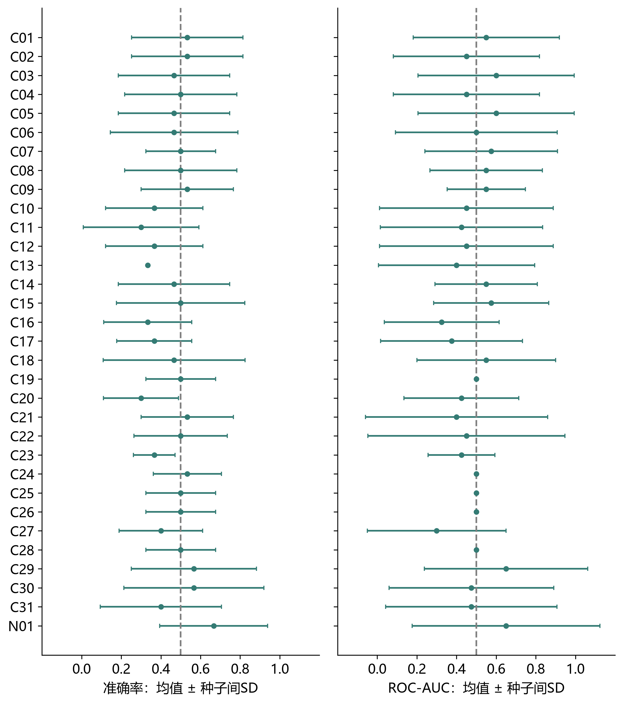

注。真实696列＋人工目标；按ID排列。AUC为正类1/三分类OvR宏平均。虚线为accuracy均匀猜测（.5或1/3）及AUC=.5参考。误差条为种子间SD，可超0–1，非独立样本置信区间。

**图 2** *表2：二分类逐模型准确率与AUC*

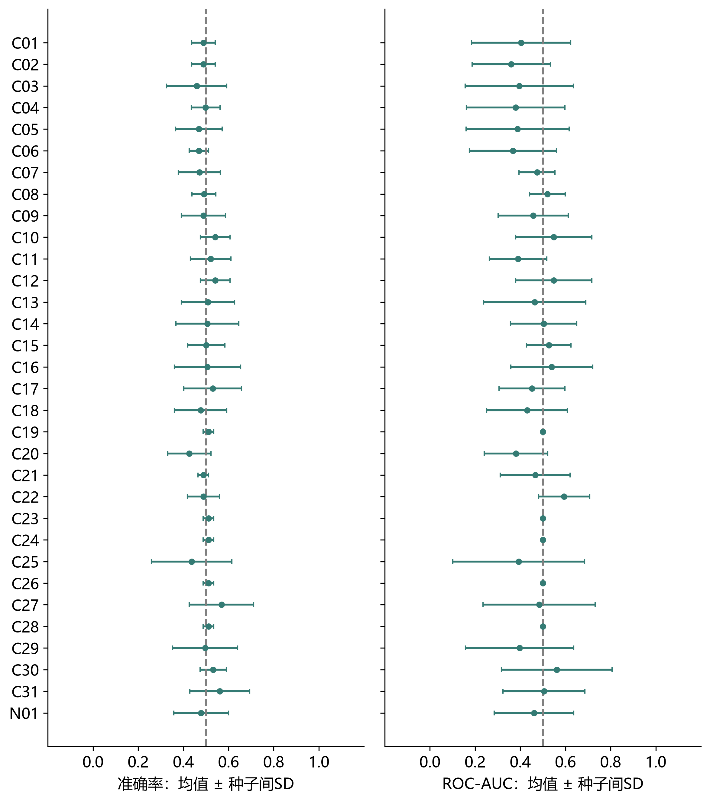

注。真实696列＋人工目标；按ID排列。AUC为正类1/三分类OvR宏平均。虚线为accuracy均匀猜测（.5或1/3）及AUC=.5参考。误差条为种子间SD，可超0–1，非独立样本置信区间。

**图 3** *表1：三分类逐模型准确率与AUC*

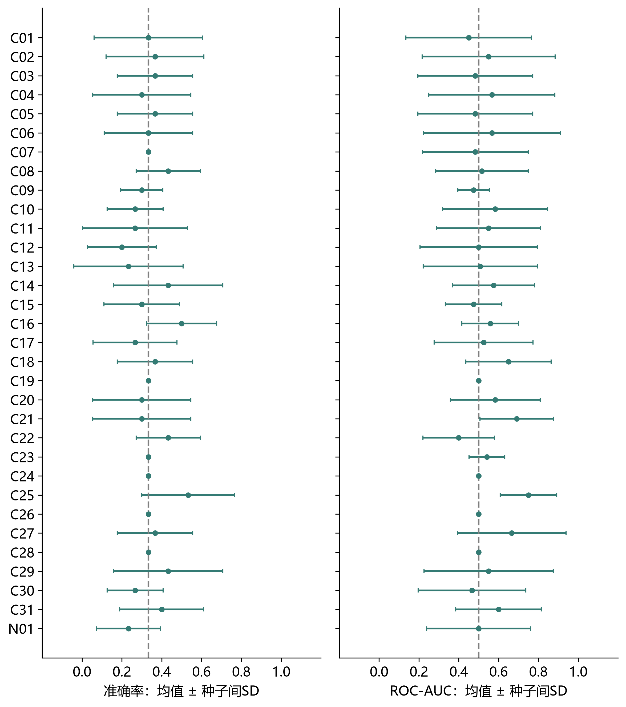

注。真实696列＋人工目标；按ID排列。AUC为正类1/三分类OvR宏平均。虚线为accuracy均匀猜测（.5或1/3）及AUC=.5参考。误差条为种子间SD，可超0–1，非独立样本置信区间。

**图 4** *表2：三分类逐模型准确率与AUC*

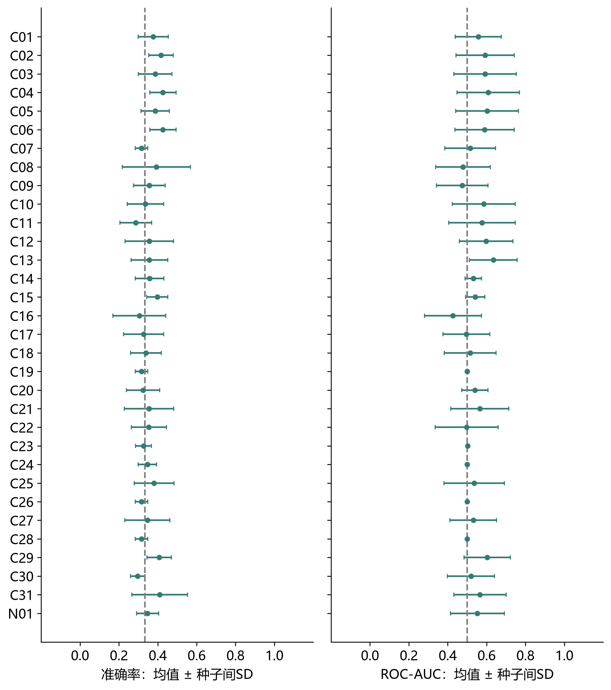

注。真实696列＋人工目标；按ID排列。AUC为正类1/三分类OvR宏平均。虚线为accuracy均匀猜测（.5或1/3）及AUC=.5参考。误差条为种子间SD，可超0–1，非独立样本置信区间。

**图 5** *表1：连续回归模型的验证误差与R²*

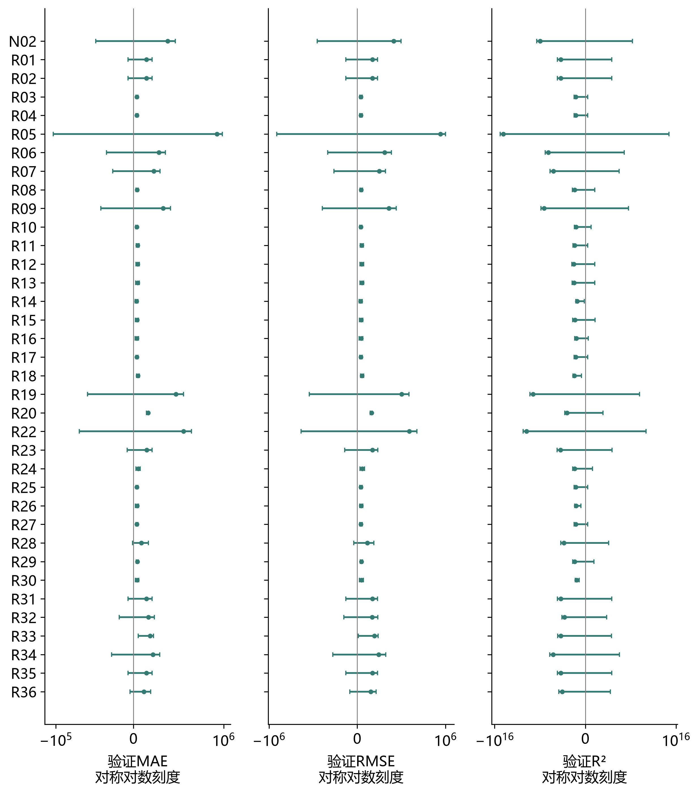

注。同一表内使用固定正连续人工目标；按ID排列。误差条为种子间SD，可越过指标取值界限；对称对数刻度保留极端值、零和负R²，|x|≤1为线性区。不可解释的R²留空。

**图 6** *表2：连续回归模型的验证误差与R²*

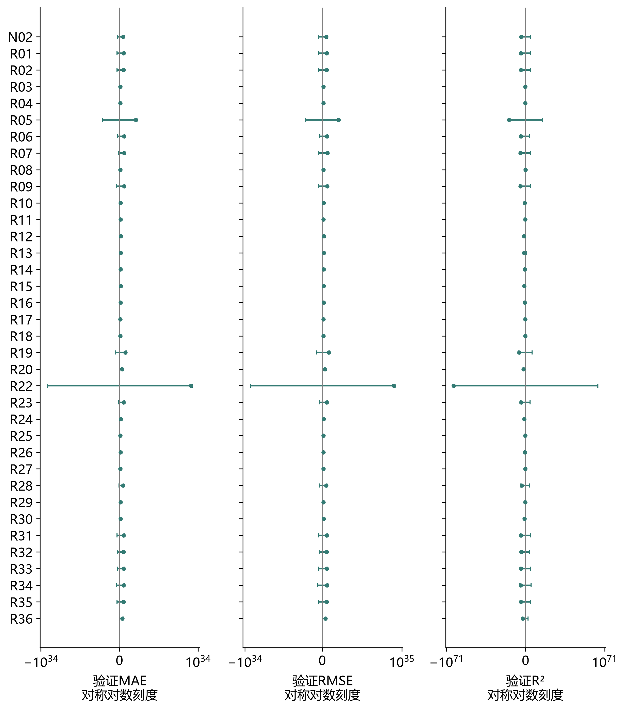

注。同一表内使用固定正连续人工目标；按ID排列。误差条为种子间SD，可越过指标取值界限；对称对数刻度保留极端值、零和负R²，|x|≤1为线性区。不可解释的R²留空。

**图 7** *连续回归固定模型的预测—目标图*

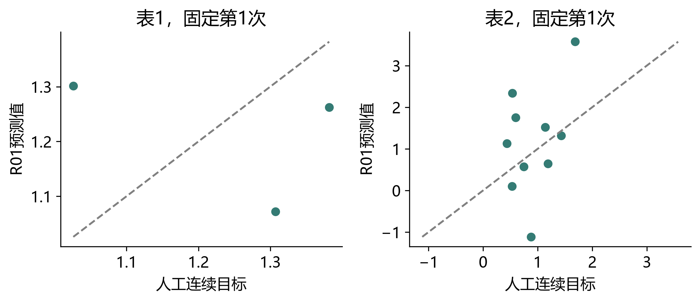

注。预先固定R01第1次，不按分数选例；对应完整验证记录。小样本和人工目标下不作生理解释。

**图 8** *人工顺序窗口回归的误差对比*

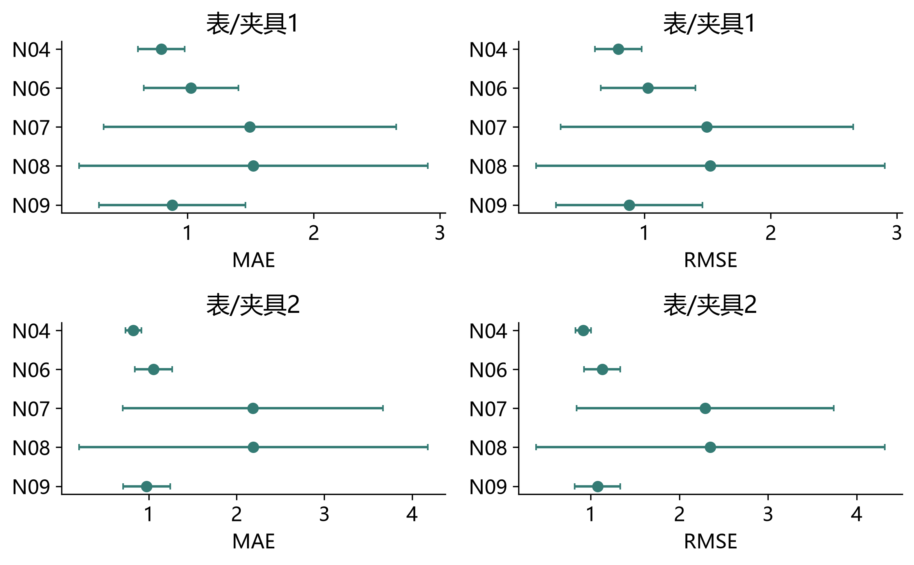

注。仅比较同一来源与评价单位的方法；窗口和人工顺序不是真实实验时间，预测适配器仅消费人工目标历史。

**图 9** *独立人工目标序列预测的误差对比*

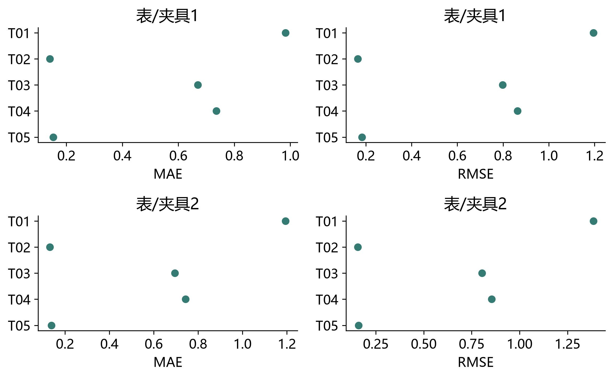

注。仅比较同一来源与评价单位的方法；窗口和人工顺序不是真实实验时间，预测适配器仅消费人工目标历史。

**图 10** *人工正计数目标的固定示例预测*

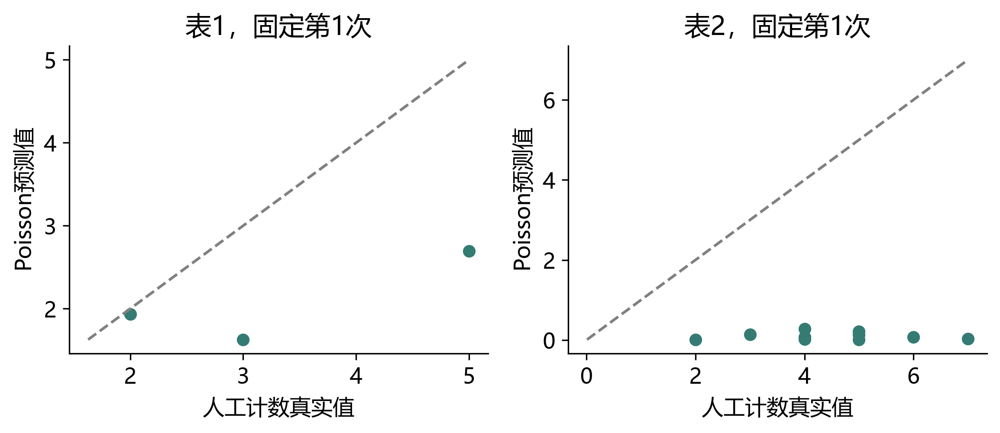

注。计数为1+Poisson(3)的工程目标，非实际事件数；偏差指标及完整结果另附。

**图 11** *ARIMA固定示例的人工目标序列预测*

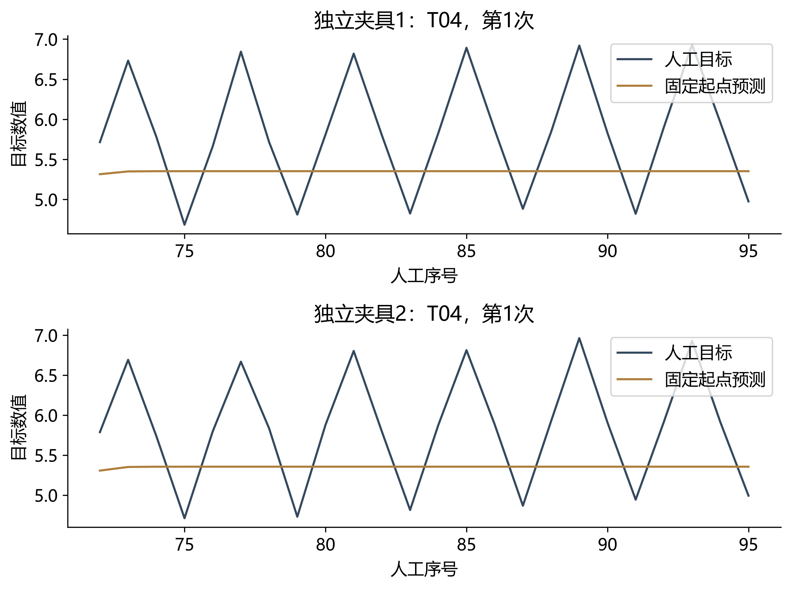

注。不使用验证目标更新历史；顺序与目标为独立夹具，不是真实EEG时间。

**图 12** *二分类与三分类固定模型的真实输入特征敏感性*

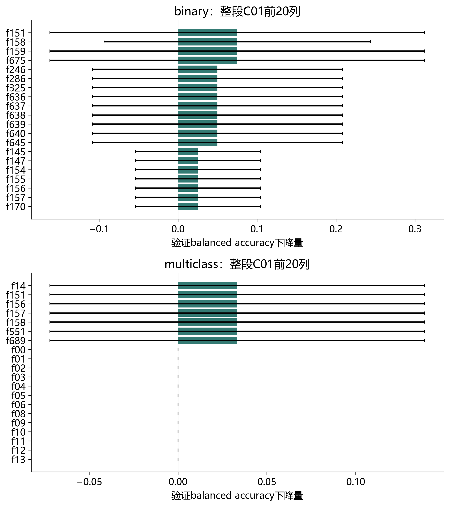

注。完整696列排序及原始特征映射另附；目标为人工，负值保留，不作脑区或因果解释。

**图 13** *真实全部特征的独立PCA描述图*

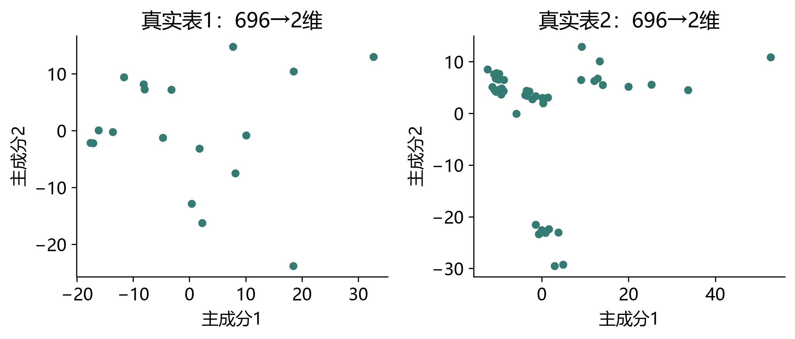

注。未使用人工目标；两表分别全量拟合，非独立验证，不把视觉分离解释为实验条件效应。

**图 14** *全任务实际执行覆盖*

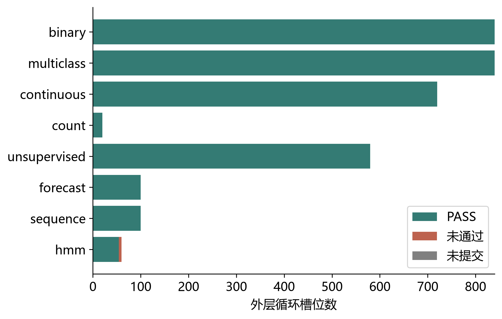

注。方法×目标类型×表×循环计数，保留失败和未提交，不以图中覆盖量代替效度。

## 参考文献

Bergstra, J., & Bengio, Y. (2012). Random search for hyper-parameter optimization. Journal of Machine Learning Research, 13, 281–305. https://jmlr.org/papers/v13/bergstra12a.html

Breiman, L. (2001). Random forests. Machine Learning, 45, 5–32. https://doi.org/10.1023/A:1010933404324

CatBoost developers. (n.d.). How training is performed. CatBoost documentation. Retrieved November 1, 2026, from https://catboost.ai/docs/en/concepts/algorithm-main-stages

Hmmlearn developers. (n.d.). Tutorial. Hmmlearn documentation. Retrieved November 1, 2026, from https://hmmlearn.readthedocs.io/en/stable/tutorial.html

LightGBM developers. (n.d.). Features. LightGBM documentation. Retrieved November 1, 2026, from https://lightgbm.readthedocs.io/en/stable/Features.html

Optuna contributors. (n.d.). optuna.samplers.TPESampler. Optuna documentation. Retrieved November 1, 2026, from https://optuna.readthedocs.io/en/stable/reference/samplers/generated/optuna.samplers.TPESampler.html

Pedregosa, F., Varoquaux, G., Gramfort, A., Michel, V., Thirion, B., Grisel, O., Blondel, M., Prettenhofer, P., Weiss, R., Dubourg, V., Vanderplas, J., Passos, A., Cournapeau, D., Brucher, M., Perrot, M., & Duchesnay, É. (2011). Scikit-learn: Machine learning in Python. Journal of Machine Learning Research, 12, 2825–2830. https://jmlr.org/papers/v12/pedregosa11a.html

PyTorch contributors. (n.d.). torch.nn. PyTorch 2.14 documentation. Retrieved November 1, 2026, from https://docs.pytorch.org/docs/2.14/nn.html

Scikit-learn developers. (n.d.). User guide. Scikit-learn documentation. Retrieved November 1, 2026, from https://scikit-learn.org/stable/user_guide.html

Skorch developers. (n.d.). NeuralNetRegressor. Skorch documentation. Retrieved November 1, 2026, from https://skorch.readthedocs.io/en/stable/regressor.html

Statsmodels developers. (n.d.). Time series analysis tsa. Statsmodels documentation. Retrieved November 1, 2026, from https://www.statsmodels.org/stable/tsa.html

UMAP developers. (n.d.). How UMAP works. UMAP documentation. Retrieved November 1, 2026, from https://umap-learn.readthedocs.io/en/latest/how_umap_works.html

van der Maaten, L., & Hinton, G. (2008). Visualizing data using t-SNE. Journal of Machine Learning Research, 9, 2579–2605. https://jmlr.org/papers/v9/vandermaaten08a.html

Varoquaux, G., Raamana, P. R., Engemann, D. A., Hoyos-Idrobo, A., Schwartz, Y., & Thirion, B. (2017). Assessing and tuning brain decoders: Cross-validation, caveats, and guidelines. NeuroImage, 145, 166–179. https://doi.org/10.1016/j.neuroimage.2016.10.038

XGBoost developers. (n.d.). Introduction to boosted trees. XGBoost documentation. Retrieved November 1, 2026, from https://xgboost.readthedocs.io/en/stable/tutorials/model.html

## 附录：全部方法差异、参数与本轮通过情况

### 模型

**表 A1** *模型差异与状态*

方法 | 机制、配置与契约 | PASS/预定
--- | --- | ---
model:C01；分类 · LogisticRegression | 以逻辑损失拟合线性类别边界；可给出类别概率，区别于最小二乘分类。；{"max_iter": 10, "n_jobs": 1}；binary; multiclass | 40/40
model:C02；分类 · RidgeClassifier | 将类别编码后作L2惩罚最小二乘；线性边界，通常无原生概率输出。；{"max_iter": 10}；binary; multiclass | 40/40
model:C03；分类 · SGDClassifier | 随机梯度优化线性分类目标；具体损失决定间隔或概率含义，学习率影响收敛。；{"max_iter": 10, "n_jobs": 1}；binary; multiclass | 40/40
model:C04；分类 · PassiveAggressiveClassifier | 对满足间隔的样本保持参数，对违例样本作受约束更新；适合在线线性分类。；{"max_iter": 10, "n_jobs": 1}；binary; multiclass | 40/40
model:C05；分类 · Perceptron | 依据误分类更新线性权重；不同于逻辑回归的概率损失，无概率模型。；{"max_iter": 10, "n_jobs": 1}；binary; multiclass | 40/40
model:C06；分类 · LinearSVC | 优化线性大间隔分类目标；区别于核SVC，不显式构造非线性核边界。；{"max_iter": 10}；binary; multiclass | 40/40
model:C07；分类 · SVC | 核支持向量分类，可学习非线性边界；C与核参数共同控制复杂度。；{"max_iter": 10}；binary; multiclass | 40/40
model:C08；分类 · KNeighborsClassifier | 由近邻类别投票；局部、非参数，距离尺度及邻居数决定结果。；{"n_neighbors": 3, "n_jobs": 1}；binary; multiclass | 40/40
model:C09；分类 · GaussianNB | 假定给定类别后特征独立且各特征服从高斯分布；适于连续输入。；{}；binary; multiclass | 40/40
model:C10；分类 · MultinomialNB | 基于非负计数/频率的多项式朴素贝叶斯；数值转为非负不自动满足计数解释。；{}；binary; multiclass | 40/40
model:C11；分类 · BernoulliNB | 建模二值特征出现与未出现；与多项式模型的计数解释不同。；{}；binary; multiclass | 40/40
model:C12；分类 · ComplementNB | 用类别补集统计量构建权重；面向非负、常见于不平衡文本计数。；{}；binary; multiclass | 40/40
model:C13；分类 · CategoricalNB | 按每个特征的离散类别概率建模；需要整数类别编码及合法取值范围。；{}；binary; multiclass | 40/40
model:C14；分类 · DecisionTreeClassifier | 递归选择特征阈值以降低节点不纯度/损失；可解释路径，但深树容易过拟合。；{"max_depth": 3}；binary; multiclass | 40/40
model:C15；分类 · ExtraTreeClassifier | 在候选特征上随机选阈值形成单树；比常规最优阈值树引入更多随机性。；{"max_depth": 3}；binary; multiclass | 40/40
model:C16；分类 · RandomForestClassifier | 聚合随机特征子集下训练的多棵树；主要以平均/投票降低单树方差。；{"n_estimators": 10, "max_depth": 3, "n_jobs": 1}；binary; multiclass | 40/40
model:C17；分类 · ExtraTreesClassifier | 聚合随机阈值树；与随机森林的区别主要在切分阈值随机化及抽样默认策略。；{"n_estimators": 10, "max_depth": 3, "n_jobs": 1}；binary; multiclass | 40/40
model:C18；分类 · GradientBoostingClassifier | 按当前损失梯度逐阶段增加树；依赖前序模型，区别于独立树的平均。；{"n_estimators": 10, "max_depth": 3}；binary; multiclass | 40/40
model:C19；分类 · HistGradientBoostingClassifier | 先将连续特征分箱再进行梯度提升；区别于逐候选值精确搜索的树提升。；{"max_iter": 10, "max_depth": 3}；binary; multiclass | 40/40
model:C20；分类 · AdaBoostClassifier | 逐阶段调整样本权重或基学习器权重；困难/异常样本可产生较大影响。；{"n_estimators": 10}；binary; multiclass | 40/40
model:C21；分类 · MLPClassifier | 以多层前馈非线性网络拟合目标；分类与回归损失不同，需控制缩放与训练轮数。；{"max_iter": 10, "batch_size": 16, "hidden_layer_sizes": [8]}；binary; multiclass | 40/40
model:C22；分类 · LinearDiscriminantAnalysis | 假定类别条件高斯且共享协方差，得到线性判别；监督投影维度至多类别数减一。；{"n_components": 1}；binary; multiclass | 40/40
model:C23；分类 · QuadraticDiscriminantAnalysis | 每类估计独立协方差而形成二次边界；小样本下协方差估计更不稳定。；{"solver": "eigen", "shrinkage": 0.5}；binary; multiclass | 40/40
model:C24；分类 · GaussianProcessClassifier | 用核定义潜在函数先验并作分类近似推断；区别于仅寻找间隔的SVM。；{"max_iter_predict": 10, "n_jobs": 1}；binary; multiclass | 40/40
model:R01；回归 · LinearRegression | 以残差平方和拟合条件均值；无正则惩罚，受共线性和离群点影响。；{"n_jobs": 1}；continuous | 20/20
model:R02；回归 · Ridge | 平方损失加L2惩罚；收缩相关特征系数，一般不使其精确归零。；{"max_iter": 10}；continuous | 20/20
model:R03；回归 · Lasso | 平方损失加L1惩罚；可产生稀疏系数，尺度与正则强度影响选择。；{"max_iter": 10}；continuous | 20/20
model:R04；回归 · ElasticNet | 结合L1与L2惩罚；在稀疏性与相关特征共同收缩之间折中。；{"max_iter": 10}；continuous | 20/20
model:R05；回归 · SGDRegressor | 用随机梯度求解线性回归目标；区别在求解及可选损失，不自动产生非线性关系。；{"max_iter": 10}；continuous | 20/20
model:R06；回归 · PassiveAggressiveRegressor | 对超出容忍区间的误差作在线受约束更新；依赖尺度与正则控制。；{"max_iter": 10}；continuous | 20/20
model:R07；回归 · HuberRegressor | 小残差采用平方损失，大残差采用线性损失；降低大残差的影响。；{"max_iter": 10}；continuous | 20/20
model:R08；回归 · QuantileRegressor | 最小化分位数损失，估计指定条件分位数；不能直接解释为条件均值。；{}；continuous | 20/20
model:R09；回归 · LinearSVR | 线性支持向量回归，在epsilon容忍区间外惩罚误差；不同于普通平方损失。；{"max_iter": 10}；continuous | 20/20
model:R10；回归 · SVR | 用核构建非线性epsilon支持向量回归；距离尺度与核宽度重要。；{"max_iter": 10}；continuous | 20/20
model:R11；回归 · KNeighborsRegressor | 以近邻目标的局部平均/加权平均预测；缺少全局参数方程。；{"n_neighbors": 3, "n_jobs": 1}；continuous | 20/20
model:R12；回归 · DecisionTreeRegressor | 递归选择特征阈值以降低节点不纯度/损失；可解释路径，但深树容易过拟合。；{"max_depth": 3}；continuous | 20/20
model:R13；回归 · ExtraTreeRegressor | 在候选特征上随机选阈值形成单树；比常规最优阈值树引入更多随机性。；{"max_depth": 3}；continuous | 20/20
model:R14；回归 · RandomForestRegressor | 聚合随机特征子集下训练的多棵树；主要以平均/投票降低单树方差。；{"n_estimators": 10, "max_depth": 3, "n_jobs": 1}；continuous | 20/20
model:R15；回归 · ExtraTreesRegressor | 聚合随机阈值树；与随机森林的区别主要在切分阈值随机化及抽样默认策略。；{"n_estimators": 10, "max_depth": 3, "n_jobs": 1}；continuous | 20/20
model:R16；回归 · GradientBoostingRegressor | 按当前损失梯度逐阶段增加树；依赖前序模型，区别于独立树的平均。；{"n_estimators": 10, "max_depth": 3}；continuous | 20/20
model:R17；回归 · HistGradientBoostingRegressor | 先将连续特征分箱再进行梯度提升；区别于逐候选值精确搜索的树提升。；{"max_iter": 10, "max_depth": 3}；continuous | 20/20
model:R18；回归 · AdaBoostRegressor | 逐阶段调整样本权重或基学习器权重；困难/异常样本可产生较大影响。；{"n_estimators": 10}；continuous | 20/20
model:R19；回归 · MLPRegressor | 以多层前馈非线性网络拟合目标；分类与回归损失不同，需控制缩放与训练轮数。；{"max_iter": 10, "batch_size": 16, "hidden_layer_sizes": [8]}；continuous | 20/20
model:R20；回归 · GaussianProcessRegressor | 核定义函数先验并进行高斯过程回归；区间来自模型假设，不是接口PASS的含义。；{}；continuous | 20/20
model:R21；回归 · PoissonRegressor | 使用Poisson偏差与对数链接；目标非负，科研解释需要适当计数/均值方差结构。；{"max_iter": 10}；count | 20/20
model:R22；回归 · GammaRegressor | Gamma偏差与对数链接；目标严格为正，区别于Poisson的方差函数。；{"max_iter": 10}；continuous | 20/20
model:R23；回归 · TweedieRegressor | 用power指定均值—方差幂关系；默认power与实际目标尺度共同决定含义。；{"max_iter": 10}；continuous | 20/20
model:K01；聚类 · KMeans | 最小化样本到质心的平方距离；需预设簇数，偏好欧氏紧凑簇。；{"max_iter": 10, "n_clusters": 2, "n_init": 1}；unsupervised | 20/20
model:K02；聚类 · MiniBatchKMeans | 用小批量近似更新质心；牺牲部分精确优化换取可扩展性。；{"max_iter": 10, "n_clusters": 2, "n_init": 1, "batch_size": 16}；unsupervised | 20/20
model:K03；聚类 · BisectingKMeans | 递归二分簇形成层次划分；区别于KMeans直接同时更新全部质心。；{"max_iter": 10, "n_clusters": 2, "n_init": 1}；unsupervised | 20/20
model:K04；聚类 · AffinityPropagation | 通过相似度消息传递选择代表点；簇数由偏好参数和数据共同决定。；{"max_iter": 10}；unsupervised | 20/20
model:K05；聚类 · MeanShift | 沿核密度梯度寻找模态；不预设簇数，带宽决定合并尺度。；{"max_iter": 10, "n_jobs": 1}；unsupervised | 20/20
model:K06；聚类 · Birch | 以聚类特征树压缩样本再聚类；阈值决定子簇粒度与内存。；{"n_clusters": 2}；unsupervised | 20/20
model:K07；聚类 · SpectralClustering | 先对相似图作谱嵌入再划分；可处理非凸结构，通常无原生新样本预测。；{"n_clusters": 2, "n_components": 2, "n_neighbors": 3, "n_init": 1, "n_jobs": 1}；unsupervised | 20/20
model:K08；聚类 · AgglomerativeClustering | 从单点逐级合并形成层次结构；链接准则决定簇间距离，无原生新样本预测。；{"n_clusters": 2}；unsupervised | 20/20
model:K09；聚类 · DBSCAN | 用固定邻域密度连接核心点并标记噪声；无需预设簇数，密度尺度需适配。；{"n_jobs": 1}；unsupervised | 20/20
model:K10；聚类 · OPTICS | 构造可达距离排序表达多尺度密度结构；区别于单一邻域尺度的DBSCAN。；{"n_jobs": 1}；unsupervised | 20/20
model:D01；降维 · PCA | 中心化后寻找最大方差正交方向；不使用目标标签，不等同于生理信号源分离。；{"n_components": 2}；unsupervised | 20/20
model:D02；降维 · IncrementalPCA | 分批近似估计主成分；区别于一次性完整矩阵分解。；{"n_components": 2, "batch_size": 16}；unsupervised | 20/20
model:D03；降维 · KernelPCA | 在核空间提取主成分；非线性映射依赖核设置，默认核不一定非线性。；{"max_iter": 10, "n_components": 2, "n_jobs": 1}；unsupervised | 20/20
model:D04；降维 · TruncatedSVD | 对未强制中心化的矩阵作截断奇异值分解；适合稀疏表示，区别于中心化PCA。；{"n_iter": 10, "n_components": 2}；unsupervised | 20/20
model:D05；降维 · FastICA | 通过非高斯性等准则寻找统计独立成分；独立性假设强于不相关性。；{"max_iter": 10, "n_components": 2}；unsupervised | 20/20
model:D06；降维 · NMF | 在非负约束下分解为基与系数；加性成分与PCA有符号正交成分不同。；{"max_iter": 10, "n_components": 2}；unsupervised | 20/20
model:D07；降维 · FactorAnalysis | 用潜在线性因子和特征特异噪声解释协方差；区别于PCA直接最大化总方差。；{"max_iter": 10, "n_components": 2}；unsupervised | 20/20
model:D08；降维 · Isomap | 以近邻图最短路径近似流形测地距离后嵌入；图连通性影响表示。；{"max_iter": 10, "n_components": 2, "n_neighbors": 3, "n_jobs": 1}；unsupervised | 20/20
model:D09；降维 · LocallyLinearEmbedding | 保留局部线性重建权重生成嵌入；对邻居数和局部几何敏感。；{"max_iter": 10, "n_components": 2, "n_neighbors": 3, "n_jobs": 1}；unsupervised | 20/20
model:D10；降维 · TSNE | 匹配高低维邻域概率以可视化局部结构；本适配器无新样本transform，不能据图推断条件效应。；{"max_iter": 250, "n_components": 2, "perplexity": 5, "n_jobs": 1}；unsupervised | 20/20
model:A01；异常检测 · IsolationForest | 随机切分隔离样本，以平均路径长度表征异常；阈值依赖污染比例设置。；{"n_estimators": 10, "n_jobs": 1}；unsupervised | 20/20
model:A02；异常检测 · OneClassSVM | 在核空间估计正常样本支持域；nu与核宽度决定边界和异常比例约束。；{"max_iter": 10}；unsupervised | 20/20
model:A03；异常检测 · LocalOutlierFactor | 将局部密度与邻域密度比较；默认novelty=False用于已拟合样本，不能混作新样本检测。；{"n_neighbors": 3, "n_jobs": 1}；unsupervised | 20/20
model:A04；异常检测 · EllipticEnvelope | 用鲁棒位置/协方差拟合椭圆正常域；适用于近似高斯椭圆分布。；{}；unsupervised | 20/20
model:C25；分类 · XGBoost | 正则化梯度提升树实现；其优化与树控制参数不同于随机森林的独立树平均。；{"n_estimators": 10, "max_depth": 3, "n_jobs": 1}；binary; multiclass | 40/40
model:C26；分类 · LightGBM | 直方图提升树、通常按叶扩展；分箱和叶复杂度控制区别于其他提升实现。；{"n_estimators": 10, "max_depth": 3, "n_jobs": 1}；binary; multiclass | 40/40
model:C27；分类 · CatBoost | 支持类别特征处理及有序提升等机制的提升树库；本次数值夹具未验证类别优势。；{"iterations": 10, "depth": 3, "thread_count": 1}；binary; multiclass | 40/40
model:R24；回归 · XGBoost | 正则化梯度提升树实现；其优化与树控制参数不同于随机森林的独立树平均。；{"n_estimators": 10, "max_depth": 3, "n_jobs": 1}；continuous | 20/20
model:R25；回归 · LightGBM | 直方图提升树、通常按叶扩展；分箱和叶复杂度控制区别于其他提升实现。；{"n_estimators": 10, "max_depth": 3, "n_jobs": 1}；continuous | 20/20
model:R26；回归 · CatBoost | 支持类别特征处理及有序提升等机制的提升树库；本次数值夹具未验证类别优势。；{"iterations": 10, "depth": 3, "thread_count": 1}；continuous | 20/20
model:C28；分类 · DummyClassifier | 忽略输入关联，按预设常数/频率策略预测；提供基线而非学习信号。；{}；binary; multiclass | 40/40
model:C29；分类 · VotingClassifier | 组合多个基学习器的投票或数值平均；不训练负责组合的第二层模型。；{"n_jobs": 1, "cv": 2, "members": ["C01", "C14"], "member_parameters": {"C14": {"max_depth": 3}}}；binary; multiclass | 40/40
model:C30；分类 · StackingClassifier | 用基学习器的交叉验证输出训练第二层模型；区别于直接投票，需防止元学习泄漏。；{"n_jobs": 1, "cv": 2, "members": ["C01", "C14"], "member_parameters": {"C14": {"max_depth": 3}}}；binary; multiclass | 40/40
model:C31；分类 · BaggingClassifier | 在重采样子集上拟合基学习器并聚合；区别于逐阶段纠正前序误差的提升。；{"n_estimators": 10, "n_jobs": 1}；binary; multiclass | 40/40
model:R27；回归 · DummyRegressor | 以均值等固定策略输出目标；衡量复杂方法是否超越简单基线需另行有效评价。；{}；continuous | 20/20
model:R28；回归 · VotingRegressor | 组合多个基学习器的投票或数值平均；不训练负责组合的第二层模型。；{"n_jobs": 1, "cv": 2, "members": ["R01", "R12"], "member_parameters": {"R12": {"max_depth": 3}}}；continuous | 20/20
model:R29；回归 · StackingRegressor | 用基学习器的交叉验证输出训练第二层模型；区别于直接投票，需防止元学习泄漏。；{"n_jobs": 1, "cv": 2, "members": ["R01", "R12"], "member_parameters": {"R12": {"max_depth": 3}}}；continuous | 20/20
model:R30；回归 · BaggingRegressor | 在重采样子集上拟合基学习器并聚合；区别于逐阶段纠正前序误差的提升。；{"n_estimators": 10, "n_jobs": 1}；continuous | 20/20
model:R31；回归 · BayesianRidge | 在贝叶斯线性回归中估计共同权重精度和噪声精度；区别于固定惩罚的Ridge。；{"max_iter": 10}；continuous | 20/20
model:R32；回归 · ARDRegression | 为各特征估计独立精度并可剪除权重；比共同精度的BayesianRidge更具稀疏性。；{"max_iter": 10}；continuous | 20/20
model:R33；回归 · KernelRidge | 以核技巧求解L2正则最小二乘；与SVR的epsilon损失不同，通常不稀疏。；{}；continuous | 20/20
model:R34；回归 · RANSACRegressor | 反复抽样识别内点后拟合；鲁棒性依赖残差阈值和足够的内点比例。；{"max_trials": 10, "min_samples": 0.5}；continuous | 20/20
model:R35；回归 · TheilSenRegressor | 聚合子样本回归估计以获得鲁棒斜率；计算规模和高维鲁棒性有限制。；{"max_iter": 10, "n_jobs": 1}；continuous | 20/20
model:R36；回归 · PLSRegression | 提取与目标协变的潜成分再回归；有监督，区别于只保留输入方差的PCA。；{"max_iter": 10, "n_components": 2}；continuous | 20/20
model:K11；聚类 · GaussianMixture | 以高斯混合分布拟合样本并提供软归属概率；簇形状受协方差结构制约。；{"max_iter": 10, "n_components": 2, "n_init": 1}；unsupervised | 20/20
model:K12；聚类 · BayesianGaussianMixture | 以变分贝叶斯权重先验约束混合成分；可降低冗余成分权重。；{"max_iter": 10, "n_components": 2, "n_init": 1}；unsupervised | 20/20
model:K13；聚类 · HDBSCAN | 基于密度层次提取稳定簇，可标记噪声；区别于固定epsilon的DBSCAN，无原生新样本预测。；{"n_jobs": 1}；unsupervised | 20/20
model:D11；降维 · UMAP | 构建模糊近邻图并优化低维图表示；与t-SNE目标不同，可支持已拟合映射的新样本变换。；{"n_epochs": 10, "n_components": 2, "n_neighbors": 3, "n_jobs": 1}；unsupervised | 20/20
model:D12；降维 · Autoencoder | 通过瓶颈编码重建输入；非线性表示需训练，重建成功不证明保留研究相关信息。；{"max_epochs": 2, "n_components": 2, "batch_size": 16}；unsupervised | 20/20
model:T01；回归 · NaiveForecast | 朴素预测：未来均取训练末值；提供单变量固定起点基线，不学习周期。；{"max_iter": 10, "seasonal_period": 4, "order": [1, 0, 0], "seasonal_order": [1, 0, 0, 4]}；forecast | 20/20
model:T02；回归 · SeasonalNaiveForecast | 季节朴素预测：重复训练末段季节周期；依赖正确给定周期，本次为4。；{"max_iter": 10, "seasonal_period": 4, "order": [1, 0, 0], "seasonal_order": [1, 0, 0, 4]}；forecast | 20/20
model:T03；回归 · ExponentialSmoothing | 指数平滑：对历史值递减加权估计水平；本次未设置趋势或季节项，不称为完整季节模型。；{"max_iter": 10, "seasonal_period": 4, "order": [1, 0, 0], "seasonal_order": [1, 0, 0, 4]}；forecast | 20/20
model:T04；回归 · ARIMA | ARIMA：结合自回归、差分与移动平均；本次(1,0,0)，无差分和MA项。；{"max_iter": 10, "seasonal_period": 4, "order": [1, 0, 0], "seasonal_order": [1, 0, 0, 4]}；forecast | 20/20
model:T05；回归 · SARIMA | SARIMA：在ARIMA上增加季节结构；本次非季节(1,0,0)、季节(1,0,0,4)。；{"max_iter": 10, "seasonal_period": 4, "order": [1, 0, 0], "seasonal_order": [1, 0, 0, 4]}；forecast | 20/20
model:N07；回归 · 1D CNN | 一维CNN：以局部时间卷积提取窗口模式；感受野由卷积结构决定。；{"hidden_size": 8, "num_layers": 1, "batch_size": 16, "max_epochs": 2, "patience": 1, "device": "cpu"}；sequence | 20/20
model:N08；回归 · TCN | TCN：采用因果/膨胀时间卷积建模窗口依赖；区别于递归逐步状态更新。；{"hidden_size": 8, "num_layers": 1, "batch_size": 16, "max_epochs": 2, "patience": 1, "device": "cpu"}；sequence | 20/20
model:N09；回归 · Transformer | Transformer：以注意力组合窗口内信息；时间位置编码及掩码决定顺序/可见范围。；{"hidden_size": 8, "num_layers": 1, "batch_size": 16, "max_epochs": 2, "patience": 1, "device": "cpu"}；sequence | 20/20
model:H01；序列/HMM · GaussianHMM | Gaussian HMM：离散隐状态转移与单高斯发射；需明确每段序列长度。；{"n_components": 2, "n_iter": 10}；hmm | 14/20
model:H02；序列/HMM · GMMHMM | GMM HMM：每个隐状态使用高斯混合发射；比单高斯HMM增加状态内分布复杂度。；{"n_components": 2, "n_iter": 10, "n_mix": 2}；hmm | 20/20
model:H03；序列/HMM · CategoricalHMM | Categorical HMM：发射为离散符号概率；与连续高斯发射的数据契约不同。；{"n_components": 2, "n_iter": 10}；hmm | 20/20
model:N01；分类 · Sequential | Sequential分类网络：前馈非线性映射输出类别；由本包模块与skorch封装组成。；{"hidden_size": 8, "num_layers": 1, "batch_size": 16, "max_epochs": 2, "patience": 1, "device": "cpu"}；binary; multiclass | 40/40
model:N02；回归 · Sequential | Sequential回归网络：前馈映射输出连续目标；与N01的目标和损失契约不同。；{"hidden_size": 8, "num_layers": 1, "batch_size": 16, "max_epochs": 2, "patience": 1, "device": "cpu"}；continuous | 20/20
model:N04；序列回归 · LSTM module | LSTM：显式细胞状态及门控保留历史信息；以固定窗口作下一步回归，保留序列边界。；{"hidden_size": 8, "num_layers": 1, "batch_size": 16, "max_epochs": 2, "patience": 1, "device": "cpu"}；sequence | 20/20
model:N06；序列回归 · GRU module | GRU：用更新/重置门调节隐状态；与LSTM相比省去独立细胞状态。；{"hidden_size": 8, "num_layers": 1, "batch_size": 16, "max_epochs": 2, "patience": 1, "device": "cpu"}；sequence | 20/20

注。搜索和内部集成有额外拟合，不与外层槽位数混淆；各目标/表的完整配置与结果另附。

### 参数搜索

**表 A2** *参数搜索差异与状态*

方法 | 机制、配置与契约 | PASS/预定
--- | --- | ---
search:grid；grid | 网格搜索：按离散候选组合枚举；本次只搜索C的两个预设取值。；{}；binary; multiclass | 40/40
search:random；random | 随机搜索：随机采样候选；覆盖依赖预算和采样分布，本次最多2次候选拟合。；{}；binary; multiclass | 40/40
search:genetic；genetic | 遗传搜索：通过种群选择、交叉和变异提出候选；两次拟合预算仅验证执行路径。；{}；binary; multiclass | 40/40
search:annealing；annealing | 退火搜索：温度控制接受较差候选的概率；本次C为[0.25,1.0]连续范围。；{}；binary; multiclass | 40/40
search:tpe；tpe | TPE搜索：利用较好/较差候选的参数密度提出新候选；极小预算不检验长期优化优势。；{}；binary; multiclass | 40/40

注。搜索和内部集成有额外拟合，不与外层槽位数混淆；各目标/表的完整配置与结果另附。

### 训练前降维

**表 A3** *训练前降维差异与状态*

方法 | 机制、配置与契约 | PASS/预定
--- | --- | ---
reduction:pca；pca | 中心化后寻找最大方差正交方向；不使用目标标签，不等同于生理信号源分离。 本次作为C01训练前的二维转换，而非独立降维任务。；{}；binary; multiclass | 40/40
reduction:truncated_svd；truncated_svd | 对未强制中心化的矩阵作截断奇异值分解；适合稀疏表示，区别于中心化PCA。 本次作为C01训练前的二维转换，而非独立降维任务。；{}；binary; multiclass | 40/40
reduction:fast_ica；fast_ica | 通过非高斯性等准则寻找统计独立成分；独立性假设强于不相关性。 本次作为C01训练前的二维转换，而非独立降维任务。；{}；binary; multiclass | 40/40
reduction:gaussian_random_projection；gaussian_random_projection | 高斯随机投影：不按目标或方差优化方向，用随机矩阵压缩维度；区别于数据学习的PCA。 本次作为C01训练前的二维转换，而非独立降维任务。；{}；binary; multiclass | 40/40
reduction:kernel_pca；kernel_pca | 在核空间提取主成分；非线性映射依赖核设置，默认核不一定非线性。 本次作为C01训练前的二维转换，而非独立降维任务。；{}；binary; multiclass | 40/40

注。搜索和内部集成有额外拟合，不与外层槽位数混淆；各目标/表的完整配置与结果另附。
